<div align="center">

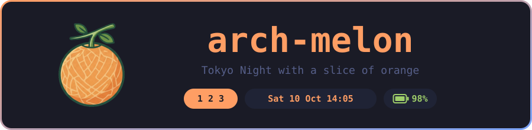

<br><br>


<a href="https://github.com/typing-words/arch-melon/actions/workflows/shellcheck.yml"></a>

<br>

A Hyprland setup for Arch Linux, born on a dual-screen laptop<br>
and made to adapt to yours.<br>
Deep night blues, one warm orange accent, rounded pills floating over the wallpaper,<br>
and a few retro touches from old consoles and games.

<br>

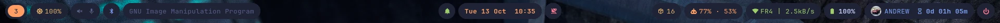

<sub><b>Hyprland</b> · Waybar · Rofi · Kitty · Starship · Mako · Hyprlock · Ly</sub>

</div>

---

> [!NOTE]
> **About the images in the screenshots.** The wallpapers, the fastfetch logo, the
> battery menu picture and the profile picture are my own choices. They are **not included**
> in arch-melon, which installs its own defaults.
> - Halo: Combat Evolved wallpapers by [u/Comfortable_Part1350](https://www.reddit.com/r/halo/comments/1qlq7xp/halo_ce_wallpapers/)
> - Dark Souls bonfire pixel art (battery menu) by [Alexander McDonald](https://www.artstation.com/artwork/YG2NNb) ([@cannonbreed](https://x.com/cannonbreed))
> - Nintendo 64 logo (fastfetch): the one shown at Nintendo's Shoshinkai 1995 show, where the console was revealed
> - Profile picture: my own photo of my LEGO

## 📸 Screenshots

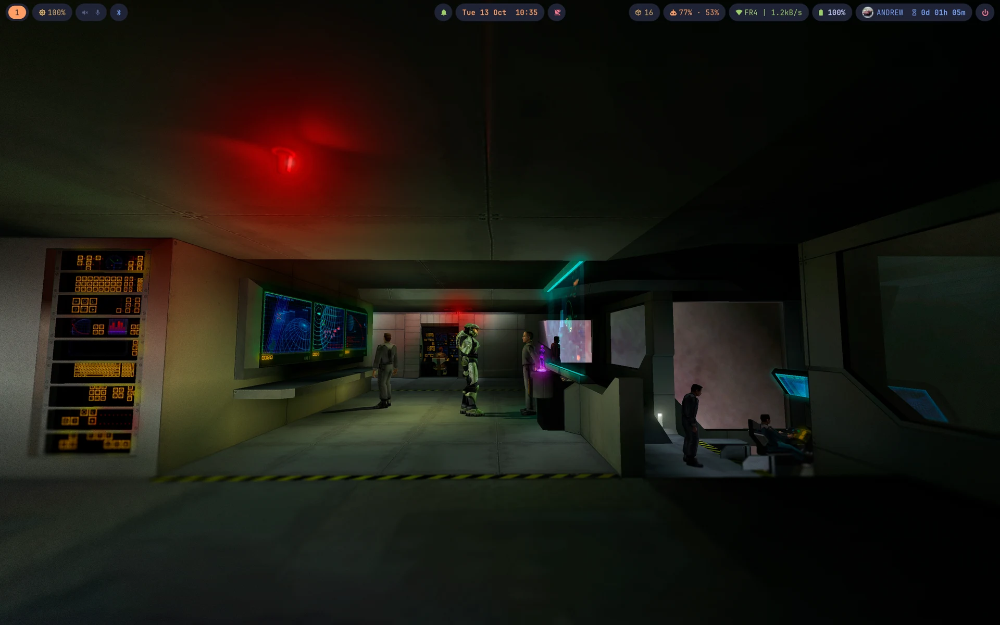

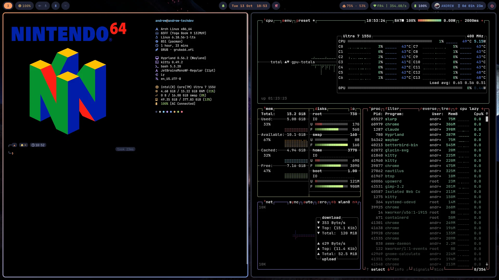

| | |
|:---:|:---:|
| 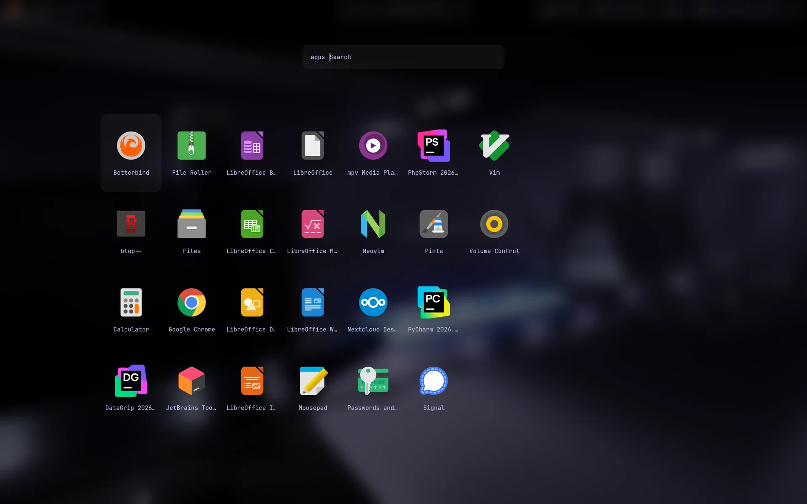 | 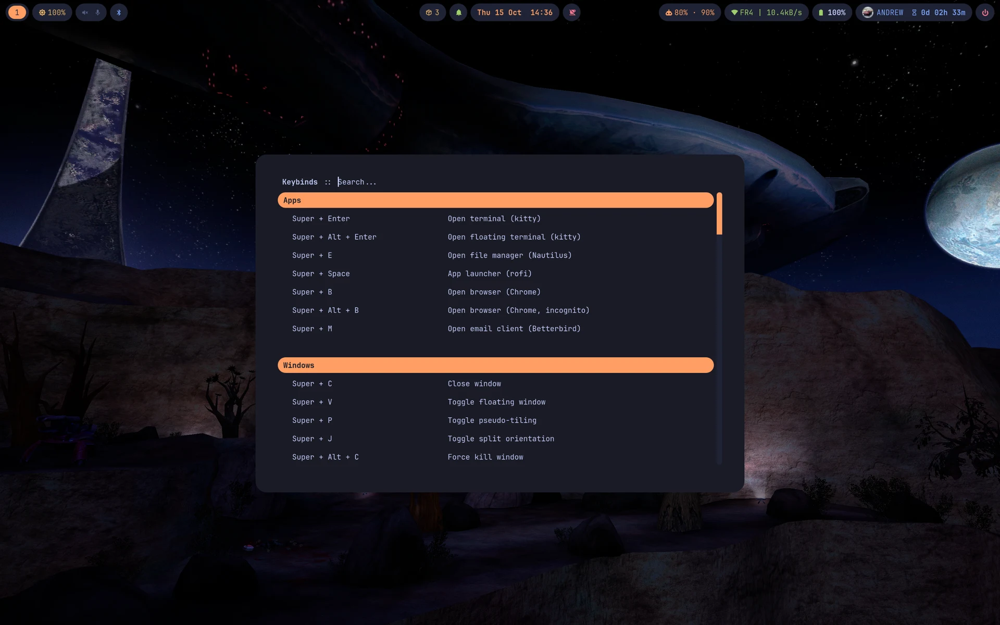 |
| **App launcher** · `Super + Space` | **Keybinds** · `Super + K` |
| 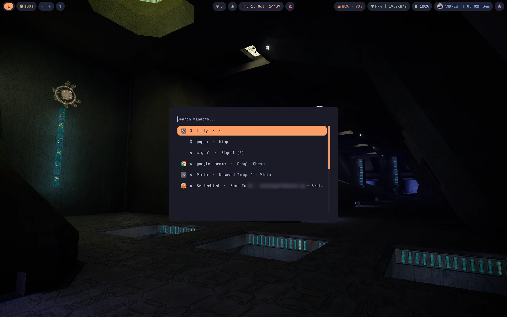 | 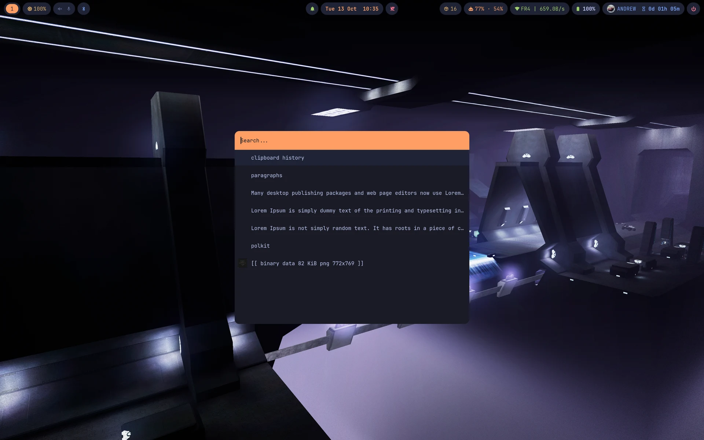 |
| **Window switcher** · `Super + Tab` | **Clipboard history** · `Super + Ctrl + V` |
| 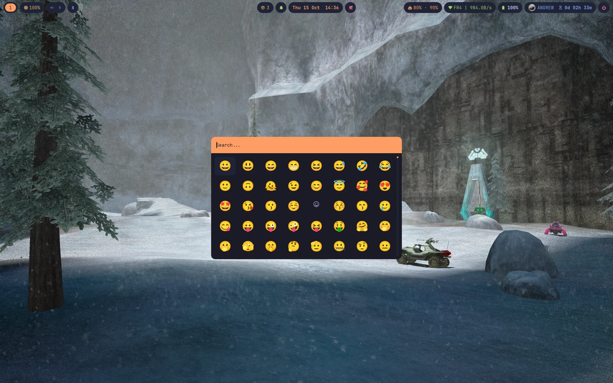 | 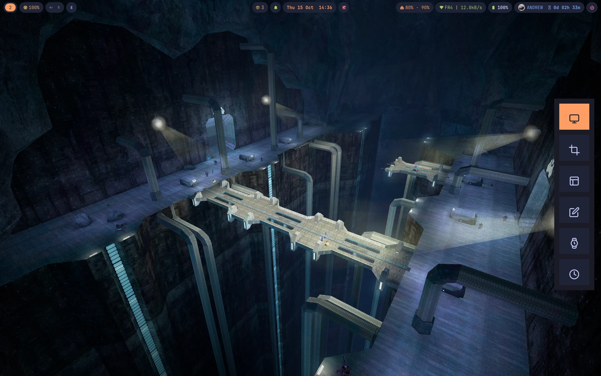 |
| **Emoji picker** · `Super + Shift + E` | **Screenshot menu** · `Print` |
| 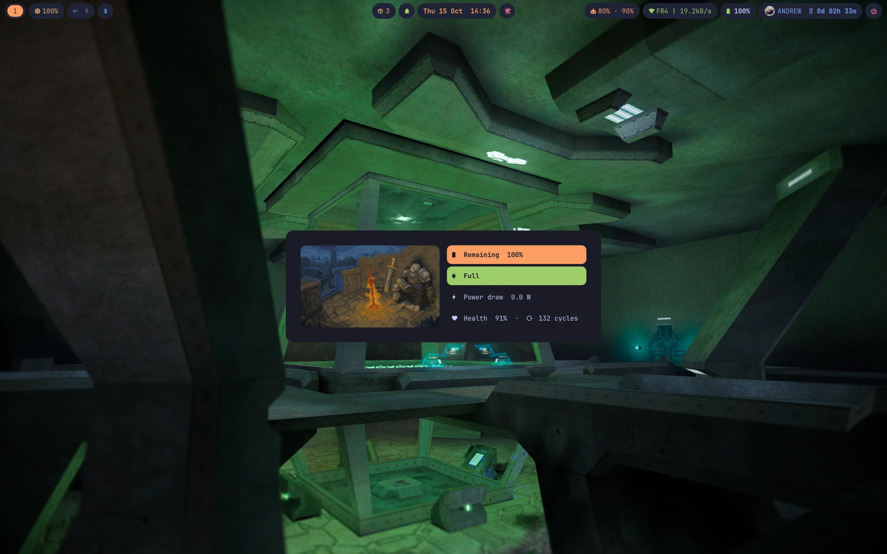 | 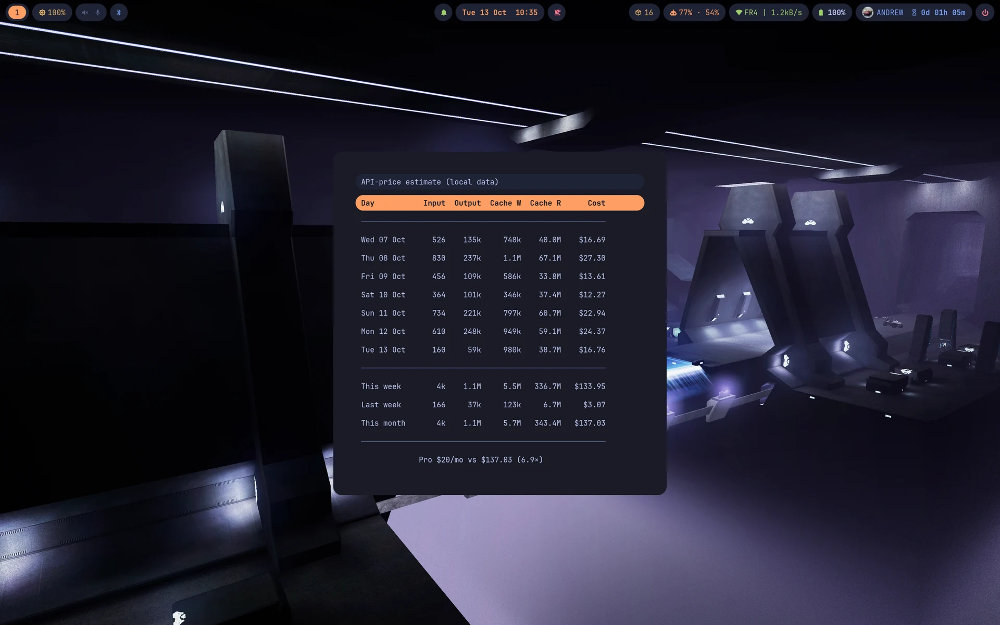 |
| **Battery** · click the battery pill | **AI usage and costs** · click the AI pill |
| 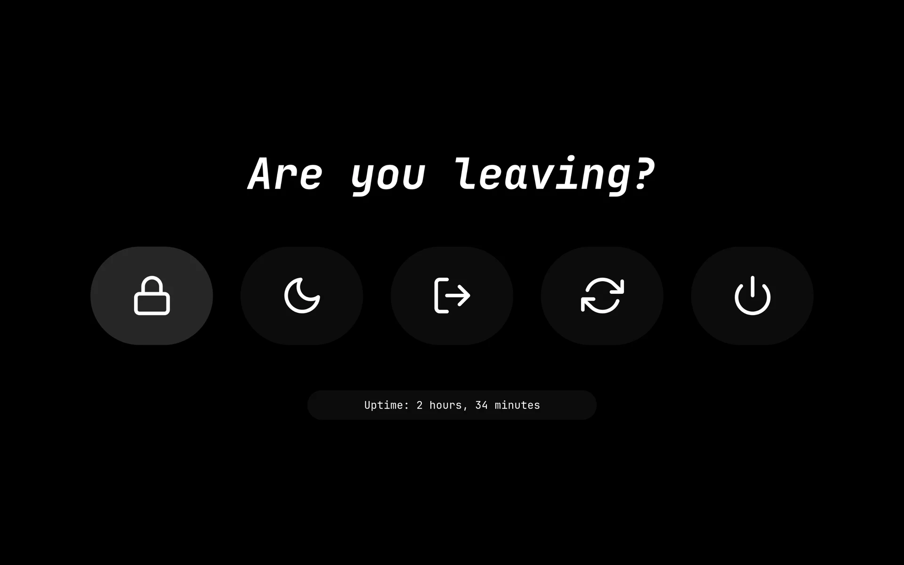 | 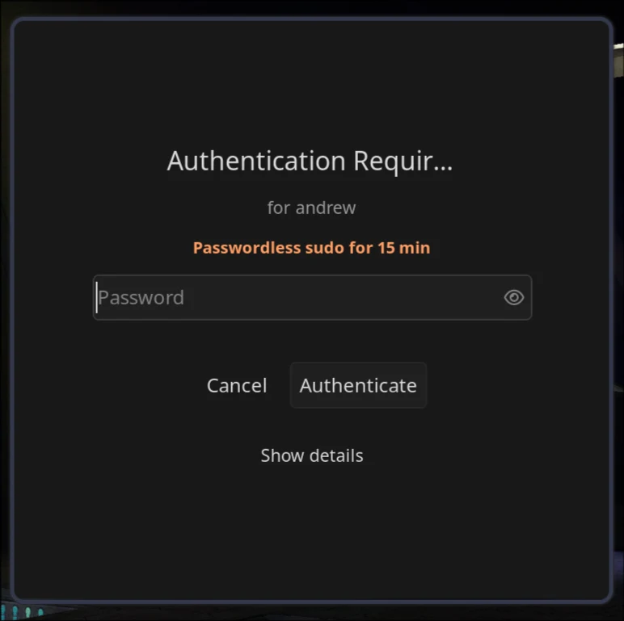 |
| **Power menu** · power key or `⏻` | **Password window** · `Super + Ctrl + S` |

<p align="center">
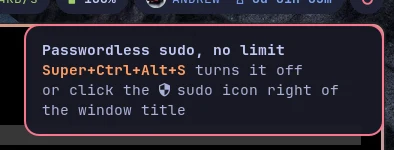<br>
<b>Notifications</b> (mako)
</p>

---

## ✨ The style

### 🎨 Palette

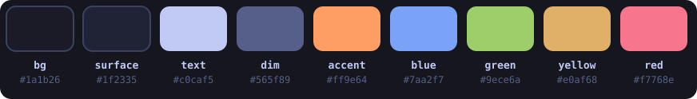

The whole rice uses one palette: **Tokyo Night** for the base, with
**orange** as the only accent. If something is orange, it's the thing you are
looking at: the active window, the active workspace, the selected menu entry,
the clock, the cursor.

| Role | Color | Used for |
|---|---|---|
| Background | `#1a1b26` | Notifications, menus, lock screen |
| Surface | `#1f2335` | Every pill (bar modules, password field) |
| Text | `#c0caf5` | Normal text |
| Dim | `#565f89` | Secondary text, window title, week numbers |
| **Accent** | **`#ff9e64`** | Active / selected / focused, clock, cursor |
| Blue | `#7aa2f7` | Second half of the border gradient, OSD |
| Green | `#9ece6a` | Good: network up, charging, notifications on, Keep Awake on |
| Yellow | `#e0af68` | Attention: low battery, updates, Caps Lock |
| Red | `#f7768e` | Critical: battery ≤15%, errors, power button |

Colors always mean the same thing: green is fine, yellow wants attention,
red needs it now.

### 📐 Design rules

- **Pills.** Nothing sits on a solid bar. Each Waybar module is its own
  rounded capsule floating over the wallpaper, and the same shape returns in
  the prompt, the password field and the menus.
- **Glass.** The bar, menus and lock screen let the wallpaper through with
  blur behind them.
- **One font.** JetBrainsMono Nerd Font in the terminal, bar, menus,
  notifications and lock screen. Icons come from the same font.
- **Rounded.** Windows have 8px corners, notifications 14px, pills are fully
  round.
- **Orange to blue.** The focused window gets a 3px border going from orange
  to blue at 45°; unfocused windows fade to a muted `#3b4261`.
- **Fast.** All animations run at 60% of Hyprland's default time. Windows pop
  in, workspaces fade.
- **Quiet.** Things only show up when they matter: the updates pill hides at
  zero, the AI pill without a Claude Code login, the privacy pill only appears while the mic or screen is in use.
- **One exception.** The power menu covers the screen in solid black, so
  leaving the session never feels like just another menu.

### 🕹️ Retro touch

- **Doom fire** animation on the Ly login screen.

---

## 🧩 Components

| Part | Tool | Look |
|---|---|---|
| Window manager | Hyprland | Gaps 5/10, orange→blue gradient border, blur, shadows |
| Bar | Waybar | Transparent bar, one pill per module, one bar per monitor |
| Menus | Rofi (adi1090x themes) | Shared `rice.rasi` colors, orange selection, Papirus icons |
| Terminal | Kitty | Black background, orange beam cursor with trail, powerline tabs, copy on select |
| Prompt | Starship | Two lines, rounded pills, orange `╰─❯` (red after an error) |
| Notifications | Mako | Top right, orange border, gray for low, red for critical |
| Lock screen | Hyprlock | Blurred desktop, big orange clock, round profile picture |
| Login | Ly | Text login with Doom fire |
| GTK | Adwaita-dark | Papirus-Dark icons with `paleorange` folders |
| Cursor | Bibata-Modern-Amber | Amber to match the accent |

---

## 📊 Waybar

```
[ workspaces ][ brightness ][ audio ][ bluetooth ][ window title ][ ● ]   [ dnd ][ clock ][ idle ]   [ privacy ][ updates ][ claude ][ network ][ battery ][ user ][ ⏻ ]
```

<details>
<summary><b>Every module and what it does</b></summary>

| Module | Shows | Click | Other |
|---|---|---|---|
| workspaces | Workspace ids. Active = orange pill, urgent = red | Switch (needs Waybar 0.16+) | |
| backlight | `󰃟 NN%` in yellow | | Wheel: every screen's backlight together |
| pulseaudio | Volume + mic | pavucontrol | Right: mute · Middle: mute mic · Wheel: ±5% |
| bluetooth | Connected devices (battery in tooltip) | bluetui | |
| window | Focused window title, dim | Screenshot menu | Hidden on empty workspaces |
| custom/sudo | Red `󰒃` while sudo needs no password | Turn it off | Hidden otherwise · hover: until when |
| custom/recording | Red `●` while recording the screen | Stop and save | Hidden otherwise |
| custom/updates | `󰏗 N`, only when there are updates | Update list + yay in a floating kitty | Count refreshes right after |
| custom/dnd | Bell (green; red with zZ in do-not-disturb) | Toggle do-not-disturb | Right: restore last notification |
| clock | `Sat 10 Oct  14:05`, orange bold | | Hover: calendar with ISO weeks · Wheel: month · Right: month/year · Middle: today |
| custom/keepawake | Keep Awake cup: green on (no lock or suspend), red off | Toggle | Also `Super + Ctrl + I` |
| privacy | Red, only while screen or mic is in use | | |
| custom/claude | `󰚩 S% · W%`: Claude plan left (session · week) | Cost table in rofi | Yellow ≤25%, red ≤10% · hidden without a Claude Code login |
| network | `󰤨 SSID \| speed` in green | impala | Hover: signal, IP, down/up |
| battery | Bold `NN%`, watts while charging | Battery menu | Icon fades green → yellow → orange → red → dark red (≤5%); green charging |
| user | Round profile picture, name, uptime | | |
| custom/power | Red `⏻` | Power menu | |

</details>

---

## ⌨️ Keybinds

`Super` is the Windows key. `Super + K` shows all of them in rofi.

The modifiers follow one logic:

| Modifier | Meaning |
|---|---|
| `Super` | Main action |
| `+ Shift` | Move it / a variant |
| `+ Alt` | Alternate version (incognito, force kill, focus mode, resize, move silently) |
| `+ Ctrl` | System menus |

<details>
<summary><b>Full list</b></summary>

| Keys | Action |
|---|---|
| **Apps** | |
| `Super + Enter` | Kitty |
| `Super + Alt + Enter` | Floating kitty |
| `Super + Shift + Enter` | Claude Code in kitty (auto mode; needs Claude Code) |
| `Super + Space` | App launcher |
| `Super + E` | Nautilus |
| `Super + B` | Browser (`+ Alt`: incognito) |
| `Super + M` | Email |
| **Windows** | |
| `Super + C` | Close window (`+ Alt`: force kill) |
| `Super + V` | Toggle floating |
| `Super + Shift + V` | Pop-out: floating, pinned on every workspace |
| `Super + F` | Fullscreen |
| `Super + Shift + F` | No gaps, borders or rounded corners |
| `Super + Alt + F` | Focus mode: the same plus no bar |
| `Super + P` / `Super + J` | Pseudo-tiling / toggle split |
| `Super + Arrows` | Move focus |
| `Super + Shift + Arrows` | Move window |
| `Super + Alt + Arrows` | Resize window |
| **Workspaces** | |
| `Super + 1..0` | Go to workspace (again: back to the previous one) |
| `Super + Shift + 1..0` | Move window there (`+ Alt`: stay here) |
| `Super + Shift + Alt + Arrows` | Move workspace to the monitor that way |
| `Super + S` | Scratchpad (`Super + Shift + X`: send window to it) |
| `Super + Wheel` | Next / previous workspace |
| `Super + Tab` | Window switcher (all workspaces, with search) |
| `Super + D` | Show desktop (again: back) |
| **Screenshots** | |
| `Super + Shift + S / W / P` | Region / window / monitor |
| `Super + Shift + A` | Region and annotate |
| `Print` | Screenshot menu (or click the window title in the bar) |
| `Super + Shift + R` | Record a region (again: stop) — `+ Alt`: whole monitor |
| **Tools** | |
| `Super + Ctrl + V` | Clipboard history |
| `Super + Shift + E` | Emoji picker |
| `Super + Shift + C` | Color picker (hex copied) |
| `Super + Shift + T` | Copy text from the screen (OCR) |
| `Super + K` | Keybinds list |
| `Super + =` / `Super + -` | Magnifier (`Super + Shift + -`: reset) |
| **System** | |
| `Super + Ctrl + B / N / A` | Bluetooth / network / audio |
| `Super + Ctrl + P` | Power menu (also the power key) |
| `Super + Ctrl + Esc` | System monitor (btop) |
| `Super + Ctrl + O` | Docker manager (lazydocker) |
| `Super + Ctrl + D` | Do not disturb |
| `Super + Ctrl + U` | Update the system |
| `Super + Ctrl + W` | Random wallpaper |
| `Super + Ctrl + R` | Restart Waybar |
| `Super + Ctrl + M` | Mute microphone |
| `Super + Ctrl + T` | Night light |
| `Super + Ctrl + I` | Keep Awake (blocks the 15 min lock and 30 min suspend) |
| `Super + Ctrl + S` | Passwordless sudo for 15 minutes (asks the password once in the polkit window) |
| `Super + Ctrl + Alt + S` | Passwordless sudo on/off, no time limit |
| `Super + Ctrl + Alt + L` | Exit Hyprland |
| **Keys** | |
| Media keys | Volume, mute, mic, brightness, play/pause/next/prev/stop |
| Extra keys | Calculator, mail, browser, search, files, lock (for external keyboards) |

</details>

---

## 🗂️ Menus (Rofi)

| Menu | Opens with | What it does |
|---|---|---|
| Launcher | `Super + Space` | Apps with icons, cached list so it opens instantly |
| Power | Power key, `⏻` pill | Lock, suspend, logout, reboot, shutdown (confirms with ENTER / ESC buttons) |
| Battery | Battery pill | Remaining %, status, power draw, health and cycles |
| Claude | Claude pill | Token use and API-price cost per day, week and month |
| Windows | `Super + Tab` | Every open window with its icon; type to filter, Enter jumps to it |
| Clipboard | `Super + Ctrl + V` | Text and image history with thumbnails, kept in RAM: gone at shutdown or reboot |
| Keybinds | `Super + K` | Every Hyprland bind, read live, grouped; type a category to list it |
| Emoji | `Super + Shift + E` | Grid of emojis, search by name or `@food`, `@flag`…, Enter types it |
| Screenshot | `Print`, window title | Desktop, area, window, annotate, 5s / 10s delay |

Every menu scrolls one row at a time and runs an entry with one click (`config.rasi`).

---

## 🛠️ Scripts

All in `~/.local/bin` unless noted.

| Script | What it does |
|---|---|
| `osd` | Volume, mic and brightness keys. Volume shows a small mako progress popup; brightness moves every screen's backlight together |
| `update-count` | Counts pending updates (repo + AUR) for the bar and the prompt. Runs hourly (systemd user timer) |
| `system-update` | `Super + Ctrl + U` and the updates pill: lists pending updates (repo and AUR, old → new), runs yay, refreshes the count |
| `waybar-ccusage` | Claude plan usage for the bar, cached so all bars share one request every 5 minutes; refreshed right away when Claude Code renews its login (`claude-token.path`) |
| `claude-costs` | Weekly table of Claude tokens and what they would cost at API prices |
| `screenrec` | Screen recording toggle (region or monitor) with gpu-screen-recorder; red dot in Waybar while recording |
| `ocr` | Copies the text inside a selected area (tesseract, English + Spanish) |
| `nightlight` | Night light toggle with hyprsunset |
| `nopasswd` | Passwordless sudo for 15 minutes (user timer turns it off) or on/off; the polkit window says which one; mako notification when it turns on and red shield in Waybar. Deleted at boot by `/etc/tmpfiles.d/nopasswd.conf` |
| `keepawake` | Keep Awake toggle (systemd idle inhibitor) for the bar and `Super + Ctrl + I` |
| `hypr/scripts/random-wallpaper.sh` | Random wallpaper per monitor with awww |

---

## ⚙️ System

| Area | Setup |
|---|---|
| Network | iwd (Wi-Fi + DHCP) and systemd-resolved (DNS), TUIs impala and bluetui. If NetworkManager is in use, the installer keeps it |
| Login | Ly (only enabled when no other login manager is) |
| Power key | Opens the power menu instead of shutting down |
| Lid | Suspends |
| Passwords | Cancelling a polkit password window doesn't count as a failed login; 3 wrong passwords lock for 1 minute |
| Monitors | Any monitor at its preferred mode, placed automatically; add yours in `hyprland.lua` |
| Input | US international layout (dead keys: `'` + `a` = á), Right Alt is a normal Alt, 3-finger swipe changes workspace |
| Shell | bash + starship, zoxide, fzf, eza, bat, fastfetch on start, nvim as editor |

---

## 📦 Install

On a working Arch Linux install, as your user:

```bash
git clone https://github.com/typing-words/arch-melon.git
cd arch-melon
./install.sh
```

It asks before each big step:

1. Installs the packages in `packages/` (and `yay` for the AUR ones, if missing).
2. Copies `home/` into your home. **Every file it replaces is backed up first** to `~/.config/arch-melon/backup-<date>/`.
3. Lists the system files in `system/`, installs them if you say yes (old ones backed up too). What each does: [`docs/system-files.md`](docs/system-files.md).
4. Enables the services and offers to reboot; then pick Hyprland at the login screen.

Run it again to update; it makes a new backup each time.

### Uninstall

```bash
./uninstall.sh
```

Deletes the files arch-melon added, puts back the ones it replaced (from the oldest
backup, so your originals) and resets the GTK look. System files are shown first and only
changed if you say yes. Packages, services and the backups stay; it tells you how to
remove them.

### Adapt it to your machine

| What | Where |
|---|---|
| Monitors (layout, scale, rotation) | Top of `~/.config/hypr/hyprland.lua` (names: `hyprctl monitors`) |
| Browser and mail app | `browser` and `mailClient` in the same file |
| Profile picture | Replace `~/.face`, run `./install.sh` again for the round copy in the bar |
| Wallpapers | Add images to `~/Pictures/Wallpapers` (one random per monitor at login) |
| Screen recording on AMD / Intel | Install `libva-mesa-driver` / `intel-media-driver` |

Every setting is described in `~/.config/arch-melon/SYSTEM-CONFIG.txt`.

### 🤖 Agent guide

`~/.claude/skills/arch-melon/SKILL.md` is a [Claude Code](https://claude.com/claude-code) skill:
where everything lives, how to adapt it to new hardware, and fixes for the problems
already met. Claude loads it whenever a task touches this setup.

---

## 📁 Repo layout

```
install.sh        Installer
uninstall.sh      Undoes it: removes what it added, restores your backed-up files
packages/         Package lists (official repos and AUR)
home/             Copied into $HOME: .config/{hypr,waybar,rofi,kitty,mako,...}, .local/bin scripts, fonts
system/           Files for /etc and /usr (logind, Ly, iwd, polkit, faillock, nopasswd)
docs/             SYSTEM-CONFIG.txt (every setting) and system-files.md
assets/           README images, default profile picture and wallpaper
```

---

## 📜 Credits and license

- Rofi themes: [adi1090x/rofi](https://github.com/adi1090x/rofi) (GPL-3.0), trimmed to the ones these menus use, plus the fonts that come with them.
- Built on [Hyprland](https://hypr.land), [Waybar](https://github.com/Alexays/Waybar), [Tokyo Night](https://github.com/folke/tokyonight.nvim) colors and the other tools listed above.

arch-melon is released under the [GPL-3.0](LICENSE).
